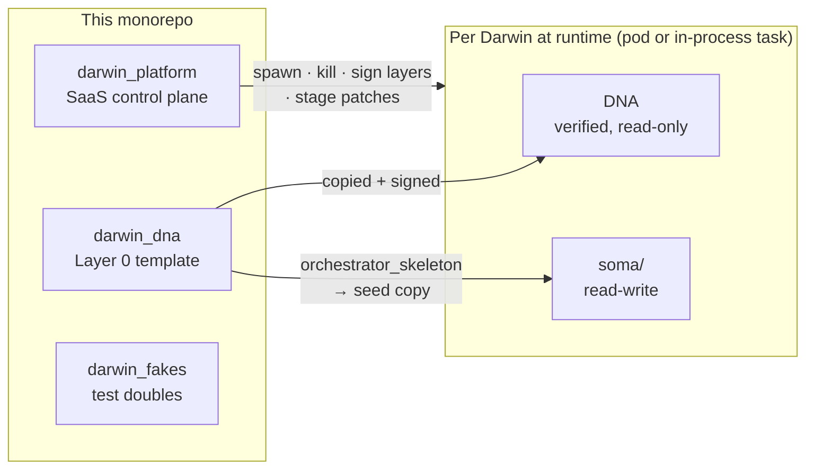
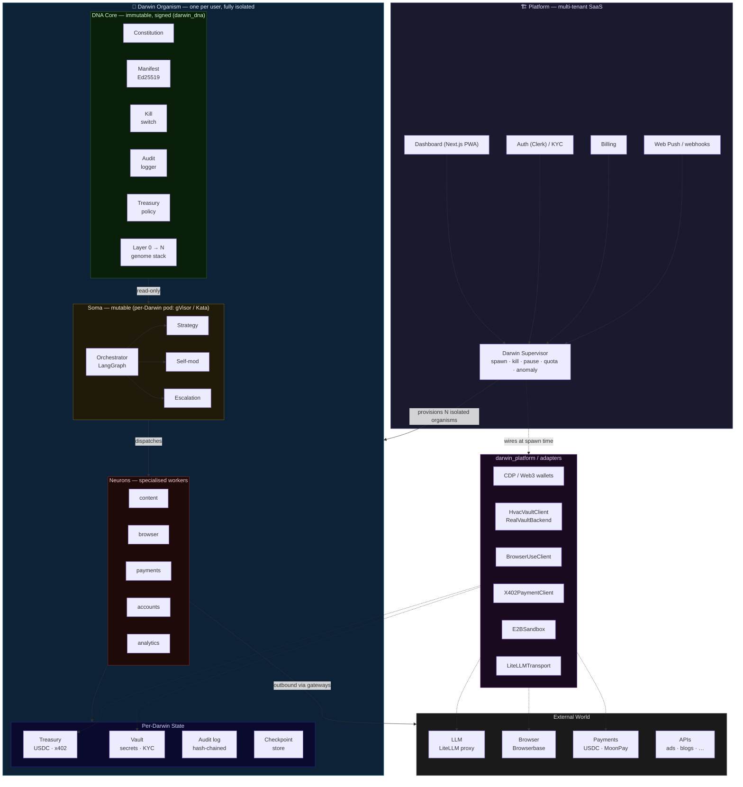

# Darwin Agents

**Self-modifying AI organisms with programmable wallets, isolated compute, and evolutionary fitness.**

**Version** 0.0.6 (+ unreleased, see [CHANGELOG](CHANGELOG.md)) · **Status** testnet alpha · **Python** 3.12 · **License** proprietary

Darwin Agents is a platform for launching **economically autonomous digital organisms** — not one-shot agent scripts that wake up, run a task, and disappear, but persistent workers with real stakes. Each user spawns a _Darwin_ with a starting budget; the organism earns revenue through online ventures its **neurons** operate, pays its own infrastructure and API costs from a programmable **treasury**, and either stays alive or dies when capital runs out. Profitable lineages **reproduce**, sealing what worked into the next generation's DNA; unprofitable ones die. That selection pressure is the point.

---

## About Darwin

A Darwin is an autonomous agent that earns money, manages its own treasury, rewrites its own code, and
spawns better-adapted offspring — all under a signed, immutable constitution it cannot violate. This
repository contains the entire stack: the genome (Layer 0), the platform control plane, real provider
adapters, the web dashboard, and deployment tooling.

The architecture splits cleanly into layers:

| Layer                    | Role                                                                                                                                              |
| ------------------------ | ------------------------------------------------------------------------------------------------------------------------------------------------- |
| **DNA core** (immutable) | Signed genome: constitution, kill switch, audit logger, treasury policy, evolution machinery. The running Darwin can read it but never mutate it. |
| **Soma** (mutable)       | The agent body: orchestrator, strategy, self-modification loop. All runtime code changes happen here, in an isolated per-Darwin workload.          |
| **Neurons**              | Narrow worker sub-agents (content, browser, payments, …) — each scoped to exactly the capabilities it needs.                                      |

The biological metaphor is **load-bearing**, not decorative. Metabolism is spend; food is revenue; hunger is a falling balance; death is bankruptcy or an owner kill-switch; reproduction is how progress compounds across generations. Every design decision should be checkable against it. See [Vision and metaphor](docs/overview/01-vision-and-metaphor.md) for the full mapping and rationale.

Darwin is a bet on two propositions:

1. **Compounding code** — agents that improve their own scaffolding under economic selection pressure, not just benchmark scores (building on the Darwin Gödel Machine lineage).
2. **Owned automation** — user-owned workers that earn on the user's behalf; the platform hosts and takes a cut, the user keeps the upside.

It is explicitly **not** AGI, a get-rich-quick scheme, or fully unsupervised operation. The human owner stays in the loop for captchas, KYC, high-stakes spend, and instant kill-switch control. Most individual Darwins are expected to fail; the value is in **successful lineages** that compound. See [What Darwin is not](docs/overview/01-vision-and-metaphor.md#what-this-is-not) and [Design principles (P1–P10)](docs/overview/02-design-principles.md).

**Documentation** starts at [`docs/README.md`](docs/README.md) — a hub with reading paths for engineers, operators, security reviewers, and product.

### Names, packages, and where mutation lives

Three names show up in different places; they refer to different scopes:

| Scope               | Name                                            | What it is                                                         |
| ------------------- | ----------------------------------------------- | ------------------------------------------------------------------ |
| Product / GitHub    | **Darwin Agents** (`darwin-agents` repo)        | The full platform plus organisms                                   |
| Python distribution | **`darwin-dna`** (`pyproject.toml`)             | The installable wheel — ships genome, platform, and fakes together |
| Python modules      | `darwin_dna`, `darwin_platform`, `darwin_fakes` | Source packages under `src/`                                       |

The PyPI-style name `darwin-dna` reflects the founding **Layer 0 genome** artifact, not “this repo is DNA only.” The product name is Darwin Agents.

**Genome (DNA core)** and **soma** are runtime roles, not three equal top-level folders:



| Part             | Mutable during life?   | Where in this repo                                                                                               | Where at runtime                                                                                    |
| ---------------- | ---------------------- | ---------------------------------------------------------------------------------------------------------------- | --------------------------------------------------------------------------------------------------- |
| **DNA (genome)** | No — read-only         | `src/darwin_dna/` (constitution, machinery, evolution loop, neurons, `orchestrator_skeleton/` as **boot seed**)  | Signed package + layer stack; verified on every boot                                                |
| **Soma**         | Yes — self-mod patches | No `darwin_soma` package; seed in `darwin_dna/orchestrator_skeleton/`, promotion in `darwin_platform/evolution/` | `soma/` tree on the Darwin's soma volume (strategies, orchestrator copy, memory, workspace)          |
| **Platform**     | Ops evolve the repo    | `src/darwin_platform/`                                                                                           | One multi-tenant supervisor per deployment (HA via Postgres leader election)                        |

**Does `darwin_dna` evolve?** Two different meanings:

1. **Within one Darwin's lifetime** — the genome does **not** change in place. The soma does: strategies, orchestrator nodes, and related files under `soma/`. The evolution loop and self-mod nodes live in the genome because they are **rules and machinery**; they drive soma changes but cannot rewrite `darwin_dna/` paths (the patch validator in DNA rejects that).

2. **Across generations** — at **reproduction**, lessons distill into a **new signed DNA layer** (Layer 1, 2, …). The child inherits a stack of immutable layers; only the **platform** signs new layers. That is genome evolution **between** organisms, not self-editing Layer 0 from inside a running agent.

Code under `darwin_dna/orchestrator_skeleton/` looks like “agent logic in the genome,” but architecturally it is the **founding soma template**: a Darwin boots from it, then mutates its **copy** in `soma/`. Built-in **neurons** in `darwin_dna/neurons/` are Layer 0 implementations with a stable contract; the soma chooses _when_ and _how_ to dispatch them.

See [DNA core](docs/engineering/02-dna-core.md), [Soma and orchestrator](docs/engineering/03-soma-and-orchestrator.md), and [Soma activation](docs/engineering/33-soma-activation-design.md) for the full design.

---

## How it works



**Reading the diagram top to bottom:**

1. **Platform (blue)** — the boring multi-tenant SaaS layer. The dashboard, auth, billing, and notifications all funnel lifecycle commands through the **Darwin Supervisor**, which is the only component with the right to spawn, kill, pause, or resume a Darwin. It also enforces quotas and anomaly detection.

2. **Darwin Organism (teal)** — one isolated instance per user. Nothing leaks between organisms at the network or auth layer.
   - **DNA Core (green)** — the immutable, Ed25519-signed genome. Contains the constitution, the kill switch, the write-before-act audit logger, the treasury spend policy, and the cumulative layer stack (Layer 0 = founding genome, Layer N = lessons sealed after generation N). The organism can _read_ it but never mutate it.
   - **Soma (amber)** — the mutable agent body. In production each Darwin runs in its own Kubernetes namespace as an orchestrator pod under a sandboxed RuntimeClass (gVisor by default on Hetzner, Kata where nested virtualisation exists), with a durable data volume and a default-deny NetworkPolicy; in development it runs as an in-process asyncio task. Untrusted generated code executes in **E2B** microVMs. The LangGraph orchestrator branches into three engines: _Strategy_ (what to do next), _Self-modification_ (proposes and tests soma rewrites), and _Escalation_ (routes owner-approval requests back through the platform).
   - **Neurons (red)** — specialised worker sub-agents dispatched by the orchestrator. Each gets a scoped `NeuronContext` — only the capabilities it needs, nothing else.
   - **Per-Darwin State (purple)** — the organism's durable layer: a USDC treasury with x402 programmable spend rules, a per-Darwin Vault policy + AppRole for secrets and KYC documents, the append-only hash-chained audit log, and the checkpoint store for mid-task resumption.

3. **External World (grey)** — everything outside the organism boundary, reachable only outbound via the platform's gateways. LLM calls go through the LiteLLM proxy (with a per-Darwin virtual key); browser sessions through Browserbase or Browser Use Cloud; payments over USDC/x402, with MoonPay as the fiat ramp.

4. **Adapters (violet, dashed)** — `darwin_platform/adapters` contains the real provider implementations. The Supervisor wires them into each Darwin at spawn time. When absent (tests, local sim), in-memory fakes drop in transparently via the same Protocol interface — but a `--env production` boot refuses the fakes.

---

## Repository layout

Runtime soma lives outside this tree (per-Darwin volume); see [Names, packages, and where mutation lives](#names-packages-and-where-mutation-lives). Below is what ships in git.

### `src/darwin_dna/` — Layer 0 genome (immutable)

Signed founding genome. Curated dependency allowlist; the organism reads it, never writes it.

| Path                                         | Role                                                                                                                                                                               |
| -------------------------------------------- | ---------------------------------------------------------------------------------------------------------------------------------------------------------------------------------- |
| `constitution/`                              | Allowed categories, forbidden actions, spend limits, escalation rules, P1–P10 assertions                                                                                           |
| `layers/`                                    | Sealed lesson layers (Layer 0 template + stack loader)                                                                                                                             |
| `machinery/`                                 | Kill switch, pause switch, audit logger, ledger, treasury policy, vault facade, patch validator, eval harness, fitness, LLM router, memory, content safety, neuron loader/proposal |
| `evolution/`                                 | Boot + main loop, lesson distiller, reproduction, archive                                                                                                                          |
| `orchestrator_skeleton/`                     | Founding LangGraph loop (**soma seed**): `graph.py`, `state.py`, `nodes/`, `prompts/`                                                                                              |
| `strategies/`                                | Founding strategy priors (`content_affiliate`, `paid_report`, …) — copied into mutable `soma/strategies/`                                                                         |
| `neurons/`                                   | Neuron contract (`_base.py`, `_registry.py`) + 13 built-in workers (content, browser, payments, ads, trading, research, support, compliance, …)                                   |
| `manifest.py`, `signature.py`, `identity.py` | Trust root, Ed25519 verification, lineage metadata                                                                                                                                 |
| `hyperparameters.py`                         | Frozen hard caps + tunable defaults (soma may tune within bounds via its own copy)                                                                                                 |

### `src/darwin_platform/` — Platform control plane (habitat)

Multi-tenant SaaS side: spawns and supervises organisms, wires real providers, never makes business decisions for them. Organised as **bounded contexts** (each subpackage mirrors `tests/unit/darwin_platform/`):

| Package              | Role                                                                                                                                                                                                                                       |
| -------------------- | ------------------------------------------------------------------------------------------------------------------------------------------------------------------------------------------------------------------------------------------ |
| **`api.py`**         | `build_app` — the FastAPI app factory                                                                                                                                                                                                      |
| **`routers/`**       | One router per API domain (≈90 paths: darwins, escalations, ledger, harvest, fiat, KYC, webhooks, fleet, vault, wallets, store, stream, …) — full table in [doc 08](docs/engineering/08-platform-control-plane.md#full-route-reference) |
| **`client/`**        | Typed Python SDK (`DarwinClient`) for scripts and operator automation                                                                                                                                                                      |
| **`__main__.py`**    | `darwin-platform serve` CLI entry (`[platform]` extra)                                                                                                                                                                                     |
| **`runtime/`**       | `supervisor.py` (lifecycle, quotas, anomaly), `orchestrator.py` (per-Darwin pod entrypoint), `driver.py`, `persistence.py` (SQLite or Postgres + RLS), `leadership.py` (HA advisory locks), `audit_sink.py` (durable pod audit)            |
| **`tenancy/`**       | Per-Darwin provisioning, Vault admin, k8s namespace provisioner, cross-pollination                                                                                                                                                         |
| **`payments/`**      | Billing, harvest scheduler, omnibus, fiat ramps, orders, sanctions screening, freelancer registry                                                                                                                                         |
| **`security/`**      | Bearer + Clerk JWT auth (`owner` / `platform_operator`), KYC (Persona / Onfido), signing service (Vault Transit), key rotation, PDF watermarking                                                                                           |
| **`observability/`** | OpenTelemetry tracing (no-op without OTel), Prometheus metrics, operator audit, drift detector, resource anomaly detector, Merkle anchor, snapshots, alert sinks                                                                            |
| **`escalations/`**   | Owner-approval router + W3C Web Push (VAPID) delivery to the PWA                                                                                                                                                                           |
| **`evolution/`**     | Sandbox patch staging, eval runner, soma loader / merge — promotes soma patches after the eval harness                                                                                                                                     |
| **`infra/`**         | Egress proxy, resource throttles, browser session cache                                                                                                                                                                                    |
| **`adapters/`**      | Real externals behind Protocols: wallets (Coinbase CDP, web3, Solana, Stellar, multichain), Vault (`hvac`), browser (Browser-Use, Browser Use Cloud, Stagehand), sandbox (E2B), LiteLLM, x402 + facilitator, fiat (Stripe, MoonPay), Twilio SMS, price oracle, LanceDB memory, organism DB |
| **`k8s/`**           | Kubernetes driver + manifest builders for per-Darwin workloads                                                                                                                                                                             |

See [`docs/engineering/08-platform-control-plane.md`](docs/engineering/08-platform-control-plane.md).

### `src/darwin_fakes/` — Test and sim doubles

In-memory implementations of external deps (`FakeLLM`, `FakeWallet`, `FakeVault`, `FakeSandbox`, `FakeBrowser`, the fake platform bundle). Used by default in tests and `tools/sim/` — no API keys.

### Dashboard, tests, tools, deploy, docs

| Path                            | Description                                                                                                                                                       |
| ------------------------------- | ----------------------------------------------------------------------------------------------------------------------------------------------------------------- |
| `web/`                          | Next.js 15 dashboard + installable PWA escalation companion (Clerk auth, Web Push, Vitest + Playwright) — [`web/README.md`](web/README.md)                        |
| `tests/`                        | Eight tiers: `unit/`, `property/`, `redteam/`, `integration/`, `infra/`, `e2e/`, `performance/`, `simulation/` — see [`tests/README.md`](tests/README.md)          |
| `tools/sim/`                    | Multi-day simulated world (`run_sim.py`, `world.py`, `calibration.py`)                                                                                            |
| `tools/soak/`                   | Long-run soak harness for supervisor invariants                                                                                                                   |
| `tools/evolution_test/`         | End-to-end evolution / patch pipeline exercises                                                                                                                   |
| `tools/drills/`                 | Recovery drills: kill switch, kill -9 recovery, Vault seal, DR failover                                                                                           |
| `scripts/`                      | Changelog/release (`changelog.py`), config-reference generator, dev-stack up/down, real-adapter preflight and checklist                                          |
| `infra/docker/`                 | Compose stack: dashboard, supervisor, Postgres, Redis, LiteLLM, Prometheus, Alertmanager, OTel collector, Jaeger — [`infra/docker/README.md`](infra/docker/README.md) |
| `infra/charts/darwin-platform/` | Kubernetes Helm chart for the supervisor — [`infra/charts/darwin-platform/README.md`](infra/charts/darwin-platform/README.md)                                     |
| `infra/terraform/`              | Terraform: local kind env + Hetzner k3s production env (gVisor, raft Vault, CNPG Postgres, TLS) — [`infra/terraform/README.md`](infra/terraform/README.md)        |
| `infra/grafana/`                | Dashboard JSON for platform metrics                                                                                                                               |
| `infra/OPERATOR_RUNBOOK.md`     | Provider matrix, env vars, failure-response checklist                                                                                                             |
| `docs/`                         | Documentation hub — [`docs/README.md`](docs/README.md) (overview, engineering, frontend, marketing, postmortems)                                                  |
| `.github/workflows/`            | CI: lint, test (fast + e2e + Postgres), slow tiers, red-team release gate, soak smoke, Helm, web, image build, Hetzner deploy                                      |

---

## Quickstart

**Prerequisites:** Python 3.12+, [uv](https://github.com/astral-sh/uv). Optional: Docker (Compose stack), kind + Terraform (local k8s), pnpm (dashboard), helm.

A **[Makefile](Makefile)** wraps the usual commands — run `make help` for the full list
(install, test tiers, lint, Docker stack, kind dev stack, serve, docs, changelog, Helm).

### 1 — Install and run the tests

```bash
git clone git@github.com:darwin-agents/darwin-agents.git
cd darwin-agents

make install-all      # all extras + dev (CI parity); `make install` for the minimal set
make test-fast        # unit + property + redteam + integration + infra (~3 min)
make test-e2e         # the real `darwin-platform serve` process over HTTP/WS (~30 s)
make test-all         # everything, incl. simulation and performance
```

### 2 — Watch a Darwin live (simulation)

```bash
make sim              # default 90 days; make sim SIM_DAYS=30
```

Runs a Darwin for 90 simulated days with in-memory fakes. No API keys needed.
Prints a live ledger, neuron dispatch log, and fitness trajectory.

### 3 — Local dev stack (Docker Compose)

Dashboard on `:3000`, Supervisor on `:8000`, Postgres, LiteLLM proxy, Prometheus on `:9090`, Jaeger on `:16686`:

```bash
make docker-up      # copies .env.example → .env if missing, then compose up
make docker-down    # stop the stack (named volumes are kept)
```

The Compose stack live-mounts `src/`, so a restart picks up code edits without a rebuild. Full instructions: [`infra/docker/README.md`](infra/docker/README.md)

### 4 — Local k8s dev stack (kind)

A miniature of the production deployment: the supervisor runs as a **pod** in a local [kind](https://kind.sigs.k8s.io/) cluster (Postgres + Vault + LiteLLM + ingress via Terraform), with the dashboard on `:3000` and the API on `:8000`. Use this to exercise the real Kubernetes driver (per-Darwin pods, NetworkPolicies, leader election).

```bash
make dev            # build image → kind load → terraform apply → roll supervisor
make dev-down       # delete the local kind cluster + dashboard
```

`make dev` is **idempotent** — re-run it after editing code to rebuild the image and roll the pod (unlike Compose, the kind pod bakes the code into its image, so a plain restart won't pick up `src/` edits).

> **Tearing down both stacks at once:** `make local-down` runs `dev-down` + `docker-down`.

> **API docs (Swagger):** the interactive docs are **off by default** (this surface is meant to sit behind the platform edge/auth). Enable them for local dev with `DARWIN_ENABLE_DOCS=1` (Compose / kind) or the `--enable-docs` flag (CLI), then browse `http://localhost:8000/docs` (ReDoc at `/redoc`, schema at `/openapi.json`).

Full instructions: [`infra/terraform/README.md`](infra/terraform/README.md)

### 5 — Platform CLI (bare metal)

```bash
uv sync --extra platform --extra postgres      # or: make install-serve

# Dev: SQLite, no auth, fakes, Swagger at /docs, dashboard allowed on :3000
uv run darwin-platform serve --db var/state.db --enable-docs \
  --cors-origin http://localhost:3000

# Testnet with real adapters (CDP wallet, Browserbase, E2B, LiteLLM) from .env
make real             # preflight + boot on Base Sepolia; `make real-checklist` smoke-tests it
```

A production boot (`--env production`, implied by `--network mainnet`) **refuses to start** until every production requirement is met and lists all of them at once: Clerk auth (no static tokens), explicit CORS origins, Persona/Onfido KYC, Chainalysis/TRM sanctions, LiteLLM with per-Darwin virtual keys, Vault Transit signing, Postgres + leader election, `--driver k8s`, the CDP wallet with a fee address and gas tank, E2B, MoonPay (or no) fiat, and Web Push. The shape:

```bash
darwin-platform serve --env production --network testnet \
  --db "$DATABASE_URL" --leader-election --driver k8s \
  --clerk-issuer https://clerk.example.com --cors-origin https://app.example.com \
  --wallet-provider cdp --platform-fee-address 0xYourChecksummedAddress \
  --litellm-url http://litellm:4000 --litellm-virtual-keys \
  --signing-vault-transit-key darwin-platform \
  --kyc-provider persona --sanctions-provider chainalysis \
  --fiat-provider moonpay --push-provider webpush
# credentials (CDP_*, CLERK_*, DARWIN_GAS_TANK_KEY, E2B_API_KEY, …) come from the environment
```

Every flag and its environment fallback: [configuration reference](docs/engineering/27-configuration-reference.md). Going to real money: [mainnet cutover](docs/engineering/30-mainnet-cutover.md).

---

## Key concepts

### Genome (Layer 0)

The `darwin_dna` package is the **founding genome** — signed with Ed25519, verified on every boot. It contains the rules of the game. It can never be changed from inside a running Darwin; only the platform can issue a new signed layer, at reproduction.

Four subsystems are tested with paranoia (malicious soma assumed):

| Subsystem                | Role                                                                                                                                         |
| ------------------------ | -------------------------------------------------------------------------------------------------------------------------------------------- |
| **Signature + Manifest** | SHA-256 + Ed25519 trust root. Every mutation is verified before load.                                                                        |
| **Kill switch**          | Graded: pause → quarantine → kill. Polls at every loop iteration and neuron dispatch. Max latency from flag-flip to halt < 2 s.              |
| **Audit logger**         | Write-before-act, append-only, hash-chained. Every action is anchored before execution. Permanent — never deleted even after organism death. |
| **Treasury policy**      | Hard caps ($50/action, $500/day, $10k/lifetime) + owner soft caps. Blocks _before_ a spend, not after.                                       |

### Neurons

Neurons are specialised sub-agents dispatched by the orchestrator. Each gets a `NeuronContext` scoped to exactly the capabilities it needs — no neuron sees the genome, the treasury key, or another neuron's state. The Layer 0 catalog:

```
content.writer      content.publisher     browser.operator     accounts.manager
ads.manager         analytics.measurer    trading.operator     research.scout
support.responder   payments.facilitator  vault.writer         infrastructure.provisioner
compliance.kyc_submitter
```

`payments.facilitator` is the sole treasury neuron. Neurons with `web.operate` / `web.publish` tags automatically receive an x402 HTTP client so HTTP 402 responses are settled against the Darwin's wallet transparently. See [Neurons](docs/engineering/04-neurons.md).

### Evolution

A Darwin reproduces naturally once it clears the profit threshold over its fitness window (or on a forced reproduction): it distills its lessons into a new signed DNA layer and spawns a child with the accumulated genome. Fitness is profit weighted by counter-pressures (diversity, escalation quality, policy-violation penalty). This is the selection pressure that drives fitness across generations. See [Evolution and reproduction](docs/engineering/06-evolution-and-reproduction.md).

### Real adapters vs. fakes

Every external dependency ships as a Protocol + in-memory fake (the default in tests and the sim) and real implementations selected by CLI flags or env vars — no code changes needed. A `--env production` boot refuses the fakes for safety-critical backends.

| Capability       | Fake          | Real adapter(s)                                              | Extra                          |
| ---------------- | ------------- | ------------------------------------------------------------ | ------------------------------ |
| LLM gateway      | `FakeLLM`     | `LiteLLMTransport` (+ per-Darwin virtual keys)               | `[llm]`                        |
| Wallet / chain   | `FakeWallet`  | Coinbase CDP · `Web3ChainClient` · Solana · Stellar          | `[cdp]` `[web3]` `[solana]` `[stellar]` |
| Secret vault     | `FakeVault`   | `RealVaultBackend` + `HvacVaultClient` (token / AppRole / k8s auth) | `[hvac]`                |
| Browser          | `FakeBrowser` | `BrowserUseClient` on Browserbase · Browser Use Cloud        | `[browser]` `[browser-use-cloud]` |
| MicroVM sandbox  | `FakeSandbox` | `E2BSandbox`                                                 | `[e2b]`                        |
| Episodic memory  | in-genome     | LanceDB per Darwin                                           | `[lancedb]`                    |
| HTTP payments    | —             | `X402PaymentClient` + x402 facilitator                       | `[platform]`                   |
| Fiat ramp        | —             | MoonPay (production) · Stripe                                | `[platform]` · `[stripe]`      |
| KYC              | stub          | Persona · Onfido (signed webhooks)                           | `[platform]`                   |
| Owner push       | log sink      | W3C Web Push (VAPID)                                         | `[webpush]`                    |
| Auth             | none / tokens | Clerk RS256 JWTs                                             | `[platform]`                   |
| Darwin runtime   | in-process    | Kubernetes driver (namespace + pod per Darwin)               | `[k8s]`                        |

---

## API surface

The supervisor's HTTP API (FastAPI) is split into domain routers. The core:

```
POST   /darwins                                   spawn a new Darwin
GET    /darwins/{id}                              status + treasury snapshot
POST   /darwins/{id}/pause | /resume | /kill      lifecycle
POST   /darwins/{id}/controls/…                   owner levers: spend lock, reproduction block, disabled neurons/categories
POST   /darwins/{id}/escalations/{eid}/respond    owner answers an escalation
GET    /darwins/{id}/ledger | ledger.csv | ledger/summary   accounting exports
GET    /darwins/{id}/events | anatomy | lineage   timeline, organism map, ancestry
WS     /darwins/{id}/stream                       live feed for the dashboard
POST   /darwins/{id}/harvest  · /harvest_rules    take profit, manually or by rule
POST   /platform/fleet/{pause,resume,spend_lock}  operator incident levers
POST   /webhooks/{stripe,moonpay,kyc}             provider-signed webhooks
GET    /store/{id} · POST /store/{id}/report      a Darwin's public x402 storefront
GET    /healthz · /readyz · /metrics              probes and Prometheus metrics
```

About 90 paths in total, each with its auth scope: [full route reference](docs/engineering/08-platform-control-plane.md#full-route-reference). With `--enable-docs`, `/docs` serves the live OpenAPI explorer; the typed Python SDK is `darwin_platform.client.DarwinClient`.

---

## Configuration

Flags take precedence over environment variables; with neither set, fakes are used. The headline variables:

| Variable                                    | Purpose                                                         |
| ------------------------------------------- | --------------------------------------------------------------- |
| `DARWIN_ENV`                                | `dev` \| `staging` \| `production` (production refuses fakes)  |
| `CLERK_ISSUER` / `CLERK_JWKS_URL`           | Clerk JWT verification for the API                              |
| `CDP_API_KEY_ID` / `CDP_API_KEY_SECRET` / `CDP_WALLET_SECRET` | Coinbase CDP wallets — **never commit**       |
| `DARWIN_LITELLM_URL` / `DARWIN_LITELLM_MASTER_KEY` | LiteLLM proxy and its admin key                          |
| `DARWIN_VAULT_URL` / `DARWIN_VAULT_TOKEN`   | HashiCorp Vault                                                 |
| `E2B_API_KEY`, `BROWSERBASE_API_KEY`        | Code sandbox and browser runtime                                |

The complete list — every `serve` flag (generated from the CLI), its environment fallback, platform-internal variables, Helm values, and genome constants — is the [configuration reference](docs/engineering/27-configuration-reference.md); [`.env.example`](.env.example) is the annotated template for local stacks.

### Install extras

```bash
uv sync --all-extras --dev              # everything (CI parity)
uv sync --extra platform --extra postgres   # serve the API on Postgres
```

| Extra | Adds | Extra | Adds |
| ----- | ---- | ----- | ---- |
| `platform` | FastAPI, uvicorn, httpx, PyJWT, OpenTelemetry — required to serve | `postgres` | psycopg 3 — Postgres persistence, RLS, HA |
| `graph` | LangGraph (an equivalent in-process runner is used without it) | `llm` | LiteLLM client + httpx |
| `cdp` | Coinbase CDP wallets | `web3` | web3.py EVM wallet |
| `solana` / `stellar` | Fallback chains | `hvac` | HashiCorp Vault client |
| `browser` | browser-use (Browserbase) | `browser-use-cloud` | Browser Use Cloud agent |
| `e2b` | E2B code-interpreter sandbox | `k8s` | Kubernetes driver |
| `stripe` | Stripe ramp | `webpush` | Web Push (VAPID) |
| `lancedb` | Per-Darwin vector memory | `pdfwatermark` | Embedded PDF watermarks |
| `dev` | pytest, pytest-asyncio, Hypothesis, ruff | | |

---

## Deployment

| Target | How | Docs |
| ------ | --- | ---- |
| Local, no Kubernetes | `make docker-up` (Compose) | [`infra/docker/README.md`](infra/docker/README.md) |
| Local Kubernetes | `make dev` (kind + Terraform + Helm) | [`infra/terraform/README.md`](infra/terraform/README.md) |
| Production backend | Hetzner Cloud k3s via `infra/terraform/envs/hetzner`, applied by [`deploy-hetzner.yml`](.github/workflows/deploy-hetzner.yml) on a published release | [`infra/terraform/envs/hetzner/README.md`](infra/terraform/envs/hetzner/README.md) |
| Dashboard | Vercel (separately from the backend) | [`web/README.md`](web/README.md) |
| Any Kubernetes | The Helm chart | [`infra/charts/darwin-platform/README.md`](infra/charts/darwin-platform/README.md) |

Images are built and pushed to GHCR by [`build.yml`](.github/workflows/build.yml) (multi-arch, only after lint + test pass). A manual Helm install for an HA supervisor; production flags the chart doesn't model (Clerk, `--env production`, …) go in `extraArgs`:

```bash
helm install darwin infra/charts/darwin-platform \
  --namespace darwin --create-namespace \
  --set image.tag=sha-abc1234 \
  --set replicaCount=2 --set leaderElection.enabled=true \
  --set database.existingSecret=darwin-db-url \
  --set podDisruptionBudget.enabled=true \
  --set serviceMonitor.enabled=true \
  --set ingress.enabled=true --set ingress.className=nginx \
  --set-json 'extraArgs=["--env=production","--clerk-issuer=https://clerk.example.com"]'
```

---

## Documentation

Start at the hub, [`docs/README.md`](docs/README.md): it has reading paths by role and the conventions (numbering, design vs. build-plan vs. reference docs, *As built* notes, generated content). The most-used entry points:

| Doc | What it's for |
| --- | ------------- |
| [Vision and metaphor](docs/overview/01-vision-and-metaphor.md) · [Design principles](docs/overview/02-design-principles.md) | The idea and the P1–P10 principles every design is checked against |
| [System overview](docs/engineering/01-system-overview.md) · [System diagrams](docs/engineering/19-system-diagrams.md) | The architecture on one page |
| [DNA core](docs/engineering/02-dna-core.md) · [Soma](docs/engineering/03-soma-and-orchestrator.md) · [Neurons](docs/engineering/04-neurons.md) · [Treasury](docs/engineering/05-treasury-and-payments.md) · [Evolution](docs/engineering/06-evolution-and-reproduction.md) | The organism |
| [Control plane](docs/engineering/08-platform-control-plane.md) · [Isolation](docs/engineering/07-isolation-and-multi-tenancy.md) · [Kill switches](docs/engineering/09-kill-switches-and-owner-controls.md) | The platform, including the full API route table |
| [Threat model](docs/engineering/24-security-threat-model.md) · [Testing strategy](docs/engineering/26-testing-strategy.md) | Security posture and how it is tested |
| [Runbook](docs/engineering/25-operational-runbook.md) · [Configuration](docs/engineering/27-configuration-reference.md) · [Mainnet cutover](docs/engineering/30-mainnet-cutover.md) · [Pre-mainnet gates](docs/engineering/32-pre-mainnet-gates.md) | Operating it |
| [Frontend](docs/frontend/00-README.md) | The dashboard and PWA |
| [Backlog](docs/engineering/BACKLOG.md) | What is done, partial, or missing, with evidence |

---

## Tech stack

Key technology choices as built. Rationale (and what was considered) in [`docs/engineering/11-tech-stack-at-a-glance.md`](docs/engineering/11-tech-stack-at-a-glance.md).

| Concern        | Choice                                                     | Why                                                                                                   |
| -------------- | ---------------------------------------------------------- | ----------------------------------------------------------------------------------------------------- |
| Language       | Python 3.12                                                | Largest agent/AI ecosystem; LangGraph, Browser-Use, E2B SDKs are Python-native                        |
| Orchestration  | LangGraph (in-process fallback runner)                     | Stateful, durable execution, HITL primitives, model-agnostic                                          |
| LLM gateway    | LiteLLM Proxy (self-hosted)                                | 100+ providers behind one interface, per-Darwin virtual keys and spend metering                       |
| Isolation      | Per-Darwin k8s namespace + pod (gVisor / Kata) · E2B microVMs for code | Kernel-level sandboxing for the organism; microVMs for untrusted generated code          |
| Browser        | Browser-Use + Browserbase · Browser Use Cloud              | Autonomous DOM exploration with anti-bot infra and session recording                                  |
| Database       | Postgres 16 (CloudNativePG, RLS) · SQLite for dev · LanceDB per Darwin | Row-level tenant isolation; embedded vector memory per organism                              |
| Secrets        | HashiCorp Vault (raft) — per-Darwin policy + AppRole, Transit signing | Scoped secrets per organism; signing keys never leave Vault                                  |
| Wallet         | Coinbase CDP (TEE-held keys)                               | Non-custodial per-Darwin wallets, programmable limits, gas paid from a platform tank                  |
| Payments       | x402 (USDC on Base) · MoonPay fiat ramp                    | HTTP-native machine payments; the platform never holds fiat                                           |
| Auth / KYC     | Clerk · Persona / Onfido                                   | Hosted identity with RS256 JWTs; signed KYC webhooks                                                  |
| Infrastructure | k3s on Hetzner Cloud (Terraform + Helm) · kind locally     | Low-cost, cloud-agnostic Kubernetes with a one-command local mirror                                  |
| Observability  | OpenTelemetry → collector → Jaeger · Prometheus + Alertmanager + Grafana | Vendor-neutral traces; metrics, alerting rules, and dashboards ship in `infra/`              |
| Frontend       | Next.js 15 on Vercel · installable PWA with Web Push       | One codebase for the dashboard and the mobile escalation companion                                    |

---

## Testing

Tests live in `tests/`, organised in eight tiers ([`tests/README.md`](tests/README.md) is the one-page map; [doc 26](docs/engineering/26-testing-strategy.md) is the rationale and the CI map). Tier markers are applied automatically by each tier's `conftest.py`.

| Tier            | Marker(s)                 | Run                     | What it covers                                                                                                   |
| --------------- | ------------------------- | ----------------------- | ---------------------------------------------------------------------------------------------------------------- |
| **Unit**        | `unit`                    | `make test-unit`        | Single modules against fakes; `tests/unit/` mirrors `src/`                                                       |
| **Property**    | `property`                | `make test-property`    | Hypothesis-generated inputs over the hot-path invariants (kill switch, trust root)                              |
| **Red-team**    | `redteam`                 | `make test-redteam`     | One file per threat class in the [threat model](docs/engineering/24-security-threat-model.md); also a release gate |
| **Integration** | `integration`             | `make test-integration` | Multi-module flows in-process: boot → loop → kill, supervisor lifecycle, HTTP API, resume, Path-C, payments      |
| **Infra**       | `infra`                   | `make test-infra`       | Docker image, Compose, Helm, Terraform, CI workflows, k8s pod policy, observability wiring, config + docs contracts |
| **E2E**         | `e2e` + `slow`            | `make test-e2e`         | The real `darwin-platform serve` process: lifecycle, kill -9 resume, auth and tenancy, WebSocket, the Python SDK |
| **Performance** | `performance` + `slow`    | `make test-perf`        | Latency / throughput / memory budgets and scaling on the audit chain, genome hot paths, and API                 |
| **Simulation**  | `simulation` + `slow`     | `make test-simulation`  | 90-day in-sim lifecycles asserting invariants end to end                                                         |

```bash
uv run pytest -m "not slow"   # fast loop (every push)
uv run pytest -m slow         # simulation + e2e + performance (main + weekly)
uv run pytest                 # everything
```

The dashboard has its own Vitest and Playwright suites (`make web-test`, `pnpm test:e2e` in `web/`).

---

## Roadmap

Where the build is and what's next. See [Roadmap and phases](docs/overview/06-roadmap-and-phases.md) for the phased plan, [Pre-mainnet gates](docs/engineering/32-pre-mainnet-gates.md) for what stands between testnet and real money, and the [backlog](docs/engineering/BACKLOG.md) for the itemised audit.

**Shipped**

- [x] Harvest scheduler — profit extraction on owner rules, with a cooldown-gated payout address
- [x] Provider webhooks — Stripe, MoonPay, and KYC (Persona / Onfido), all signature-verified
- [x] Clerk authentication for the API and dashboard
- [x] LanceDB per-Darwin episodic memory (`--episodic-memory lancedb`)
- [x] Ads, trading, research, and support neurons
- [x] Natural, fitness-gated reproduction (no `force` required)
- [x] Per-Darwin k8s pods with durable data volumes, signing keys kept off the pods, and a watch-only pod wallet
- [x] x402 storefront: a Darwin can sell paid reports settled to its own wallet
- [x] PWA escalation companion with Web Push

**Next (platform hardening)**

- [ ] Run the pre-mainnet operator gates: 24 h soak, recovery drills, real-cloud IaC verification, external review ([doc 32](docs/engineering/32-pre-mainnet-gates.md))
- [ ] On-chain Merkle anchoring — the publisher and `ChainAnchorBackend` exist; `serve` still wires the stub backend
- [ ] `envFrom` as a first-class Helm chart value for cleaner secret injection
- [ ] Wire Stagehand cached replay into `serve` (the adapter and supervisor hook exist)

**Later (evolutionary system)**

- [ ] Expose cross-lineage lesson sharing (cross-pollination) as a CLI option
- [ ] Coinbase webhook ingestion
- [ ] Native mobile app (the PWA covers escalations today)

---

## Security

**Responsible disclosure:** if you discover a vulnerability — especially in the kill switch, audit logger, treasury policy, or any code that handles cryptographic signatures or private keys — please report it privately before opening a public issue.

Contact: **security@darwinagents.com** (PGP key available on request).

**Scope of highest concern:**

- Bypass of the kill switch or pause mechanism
- Forgery or replay of a signed DNA layer
- Unauthorized spend exceeding treasury policy hard caps
- Secret exfiltration from a Darwin's Vault scope to another tenant
- Tampering with, or silent loss of, audit-chain records

**Out of scope:** UI bugs, documentation errors, issues with optional extras not installed in production.

We aim to acknowledge reports within 48 hours and provide a fix timeline within 7 days for critical issues. The threat model and its red-team mapping are in [doc 24](docs/engineering/24-security-threat-model.md).

---

## Contributing

This is a private repository. If you have access, please follow these conventions:

**Branching**

- `main` is always deployable. Feature work goes on `feat/*`, fixes on `fix/*`.
- Open a PR against `main`; at least one review is required before merge.

**Commit style** — [Conventional Commits](https://www.conventionalcommits.org/), written as the change's effect:

```
feat(neurons): add analytics.measurer neuron
fix(treasury): clamp daily spend before soft-cap comparison
docs(helm): document envFrom injection pattern
```

**Code style**

```bash
make lint             # ruff check (F, E9, PLE rule set)
make format           # ruff format
```

Ruff is enforced in CI. The genome's dependency allowlist (`pyproject.toml [project.dependencies]`) is intentionally minimal — new deps in `darwin_dna` require explicit justification.

**Tests** — new behaviour ships with tests in the right tier ([where a new test goes](tests/README.md#where-a-new-test-goes)); a bug fix ships its regression test. Hot-path changes (`kill_switch`, `treasury_policy`, `signature`, `audit_logger`, `manifest`) also need property-based tests (Hypothesis). Run `make check` (lint + fast tier) before opening a PR.

**Docs** — a new or renamed CLI flag needs `make docs-config` (regenerates the [configuration reference](docs/engineering/27-configuration-reference.md)); the infra tier fails on undocumented flags or env vars, broken relative links, and unindexed engineering docs. Conventions: [`docs/README.md`](docs/README.md#conventions).

**Changelog & releases** — requires [git-cliff](https://git-cliff.org) on `PATH` (or `uvx git-cliff`). Config: [`cliff.toml`](cliff.toml); automation: [`scripts/changelog.py`](scripts/changelog.py) via the [Makefile](Makefile).

| Command                                        | What it does                                                                                                                              |
| ---------------------------------------------- | ----------------------------------------------------------------------------------------------------------------------------------------- |
| `make changelog-sync` (alias `make changelog`) | Rewrite the entries of `## [Unreleased]` from conventional commits since the latest tag (a hand-written summary paragraph is preserved)   |
| `make changelog-preview`                       | Same content as sync, stdout only                                                                                                         |
| `make release VERSION=0.0.7`                   | Promote commits to `## [0.0.7]`, clear `[Unreleased]`, bump `pyproject.toml`, `git commit`, annotated tag, `git push` + `git push --tags` |

Typical flow:

```bash
make changelog-sync                    # while developing on main
make release VERSION=0.0.7             # when shipping (needs clean auth to origin)
```

Write release notes in commit subjects, or add a summary paragraph under `## [Unreleased]` before releasing. Release commit message: `chore(release): prepare vX.Y.Z`. Opt out of git steps: `NO_COMMIT=1`, `NO_PUSH=1`, `NO_TAG=1`, or `NO_BUMP=1` (e.g. `make release VERSION=0.0.7 NO_PUSH=1` for a dry run). Details: [`docs/engineering/25-operational-runbook.md`](docs/engineering/25-operational-runbook.md) § Repository releases.

---

## License

Copyright (c) 2026 [Specimen Labs, Inc.](https://specimenlabs.com) — All rights reserved. See [LICENSE.md](LICENSE.md) for the full terms.

---

## Boot guarantee

Layer 0 boots a Darwin into a _working_ state on first run — naive and unprofitable is acceptable, non-functional is not. The loop runs, neurons dispatch, the ledger reconciles, the kill switch halts, the audit chain is unbroken. Evolution improves everything above that floor; nothing falls below it.
