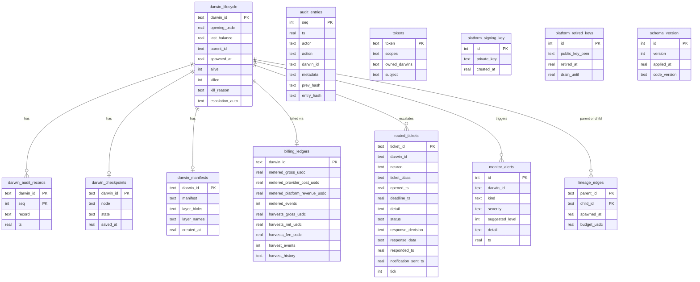
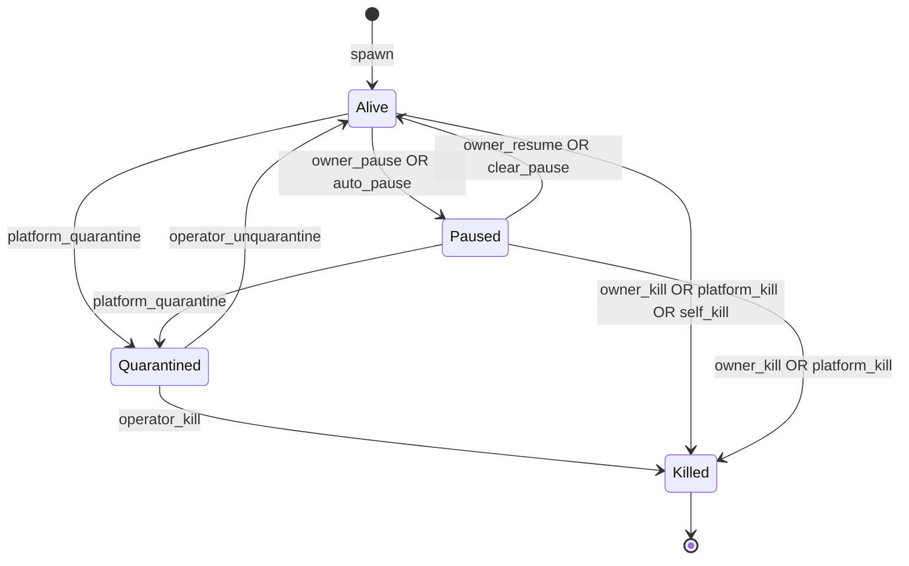

# Data model reference

The canonical schema for all persistent state in the Darwin platform. Contract tests assert against this document; any schema change that contradicts it is a bug until this doc is updated.

Two classes of data exist, as specified in [`07-isolation-and-multi-tenancy.md`](07-isolation-and-multi-tenancy.md):

- **Platform data** — billing, audit, lifecycle, lineage, escalation, checkpoints. Shared Postgres cluster, per-Darwin isolation via RLS (Phase 2) or application-level `darwin_id` filtering (Phase 0–1).
- **Organism data** — whatever the Darwin's business is about. Per-Darwin databases provisioned on demand. Not specified here; the shape is the Darwin's own problem.

## Platform schema

The schema lives in [`src/darwin_platform/runtime/persistence.py`](../../src/darwin_platform/runtime/persistence.py) as a template string substituting type flavors per backend (`REAL` for SQLite, `DOUBLE PRECISION` for Postgres; `INTEGER PRIMARY KEY AUTOINCREMENT` vs. `BIGSERIAL PRIMARY KEY`).

Current schema version: **2** (tracked in the `schema_version` table).

### Entity-relationship diagram



### Table reference

#### `darwin_lifecycle`

The source of truth for whether a Darwin is alive. The supervisor reads this on startup (leader election) to re-spawn `alive=True` entries.

| Column | Type | Constraints | Notes |
| ------ | ---- | ----------- | ----- |
| `darwin_id` | TEXT | PK | UUID4, assigned at spawn |
| `opening_usdc` | REAL | NOT NULL | Initial funding |
| `last_balance` | REAL | nullable | Most recent balance snapshot |
| `parent_id` | TEXT | nullable | NULL for generation-0 |
| `spawned_at` | REAL | NOT NULL | Unix timestamp |
| `alive` | INTEGER | NOT NULL | 1 = alive, 0 = dead |
| `killed` | INTEGER | NOT NULL | 1 = kill confirmed |
| `kill_reason` | TEXT | nullable | Human-readable death/kill reason |
| `escalation_auto` | TEXT | nullable | Unattended owner-response policy: `"approve"` / `"deny"` / NULL |

Indexed on `alive` for leader-resume scans.

#### `audit_entries`

Platform-side operator audit log (hash-chained). Every supervisor mutation is recorded.

| Column | Type | Notes |
| ------ | ---- | ----- |
| `seq` | INTEGER PK | Monotonically increasing, gap-free |
| `ts` | REAL | Unix timestamp |
| `actor` | TEXT | Authenticated subject (email, "platform", "system") |
| `action` | TEXT | Operation name (`spawn`, `kill`, `pause`, `quarantine`, ...) |
| `darwin_id` | TEXT | Nullable (fleet-wide actions have no darwin_id) |
| `metadata` | TEXT | JSON payload (action-specific) |
| `prev_hash` | TEXT | SHA-256 of the previous entry (genesis: `"0"*64`) |
| `entry_hash` | TEXT | SHA-256 of this entry (inputs: seq, prev_hash, ts, action, metadata) |

Indexed on: `actor`, `action`, `darwin_id`, `ts`.

#### `darwin_audit_records`

Per-Darwin audit records (mirrored from the genome's in-sandbox audit log to platform persistence at heartbeat boundaries). This is the durable store backing the genome's `AuditSink`.

| Column | Type | Notes |
| ------ | ---- | ----- |
| `darwin_id` | TEXT | Composite PK part 1 |
| `seq` | INTEGER | Composite PK part 2 (per-Darwin sequence) |
| `record` | TEXT | Full JSON audit record (see "Audit record shape" below) |
| `ts` | REAL | Timestamp (denormalized for efficient time-range queries) |

#### `darwin_checkpoints`

LangGraph checkpoint store. One row per Darwin; overwritten at each safe checkpoint.

| Column | Type | Notes |
| ------ | ---- | ----- |
| `darwin_id` | TEXT PK | |
| `node` | TEXT | Graph node the Darwin was at when checkpointed |
| `state` | TEXT | Full JSON serialization of `OrchestratorState` |
| `saved_at` | REAL | When the checkpoint was written |

#### `darwin_manifests`

Signed manifests and DNA layer blobs. Used to re-boot a Darwin with the same identity after a restart.

| Column | Type | Notes |
| ------ | ---- | ----- |
| `darwin_id` | TEXT PK | |
| `manifest` | TEXT | Full manifest JSON (identity + layers + signature) |
| `layer_blobs` | TEXT | JSON: `{"0": "<base64>", "1": "<base64>", ...}` |
| `layer_names` | TEXT | JSON: `{"0": "layer_0_lessons", ...}` |
| `created_at` | REAL | |

#### `billing_ledgers`

Accumulated billing state per Darwin. Updated on each metered sweep and harvest.

| Column | Type | Notes |
| ------ | ---- | ----- |
| `darwin_id` | TEXT PK | |
| `metered_gross_usdc` | REAL | Total wallet debits attributed to infra |
| `metered_provider_cost_usdc` | REAL | Platform's cost (what it pays upstream) |
| `metered_platform_revenue_usdc` | REAL | Markup revenue |
| `metered_events` | INTEGER | Count of metered transactions |
| `harvests_gross_usdc` | REAL | Total profit harvested |
| `harvests_net_usdc` | REAL | Harvests after fee |
| `harvests_fee_usdc` | REAL | Platform fee collected |
| `harvest_events` | INTEGER | Count of harvest operations |
| `harvest_history` | TEXT | JSON array of `{ts, gross, net, fee}` |

#### `lineage_edges`

Immutable parent→child relationships. Survives Darwin death.

| Column | Type | Notes |
| ------ | ---- | ----- |
| `parent_id` | TEXT | Composite PK part 1 |
| `child_id` | TEXT | Composite PK part 2 |
| `spawned_at` | REAL | When the child was spawned |
| `budget_usdc` | REAL | Starting capital transferred |

Indexed on `child_id` for parent lookups.

#### `routed_tickets`

Escalation tickets as the platform sees them (enriched with classification + deadline).

| Column | Type | Notes |
| ------ | ---- | ----- |
| `ticket_id` | TEXT PK | UUID assigned by the genome |
| `darwin_id` | TEXT | Which Darwin posted it |
| `neuron` | TEXT | Which neuron blocked |
| `ticket_class` | TEXT | `captcha` / `kyc` / `approval` / `info` / `data` |
| `opened_ts` | REAL | |
| `deadline_ts` | REAL | Auto-deny after this time (genome enforces) |
| `detail` | TEXT | JSON context |
| `status` | TEXT | `open` / `responded` / `expired` |
| `response_decision` | TEXT | `approve` / `deny` / `data` (nullable until responded) |
| `response_data` | TEXT | JSON (nullable) |
| `responded_ts` | REAL | nullable |
| `notification_sent_ts` | REAL | nullable |
| `tick` | INTEGER | Darwin tick when the ticket was observed |

#### `monitor_alerts`

Alert history for anomaly detection. Used for cooldown deduplication.

#### `tokens`

Bearer tokens for API auth. `scopes` and `owned_darwins` are JSON arrays serialized to TEXT.

#### `platform_signing_key` / `platform_retired_keys`

The platform's HSM stand-in. One active key (id=1), retired keys kept for a drain window so manifests signed before rotation still verify.

#### `schema_version`

Single-row table tracking the current schema version. Migrations run sequentially from persisted version to `CURRENT_SCHEMA_VERSION` on open.

## Darwin lifecycle state machine



### Transition guards

| Transition | Guard | Who can trigger |
| ---------- | ----- | --------------- |
| `spawn → Alive` | Opening USDC > 0; sanctions pass on owner wallet | Platform (on user request) |
| `Alive → Paused` | None (always allowed) | Owner, supervisor (auto on CRITICAL alert) |
| `Paused → Alive` | Not quarantined | Owner |
| `Alive → Quarantined` | Confirmed policy issue or compliance trigger | Platform operator only |
| `Quarantined → Killed` | Operator review complete | Platform operator only |
| `Quarantined → Alive` | Operator clears the issue | Platform operator only |
| `* → Killed` | None (always allowed; irreversible) | Owner, platform, self (treasury exhaustion) |

**Invariants:**
- A killed Darwin is never resurrected (no-resurrection rule, doc 09).
- A quarantined Darwin's wallet is locked and egress is cut.
- `alive=1` AND `killed=0` is the only state in which the drive loop runs.
- `paused` is a genome-side flag (the supervisor flips it; the genome's main loop observes it).

## Checkpoint format (`OrchestratorState`)

The checkpoint is a JSON serialization of the `OrchestratorState` pydantic model. The full shape:

```json
{
  "tick": 42,
  "alive": true,
  "halt": false,
  "paused": false,
  "death_reason": null,
  "route": "perceive",

  "balance_usdc": 55.23,
  "days_elapsed": 3.5,
  "content_pieces": 12,
  "published_pieces": 8,
  "seconds_since_revenue": 7200.0,
  "available_neurons": ["content.writer", "browser.operator", "payments.facilitator"],

  "plan": {"action": "dispatch", "neuron": "content.writer", "task": "..."},
  "last_action": "dispatch",
  "world_observations": [],

  "dispatches_done": 38,
  "successful_dispatches": 33,
  "recurring_failures": {"rate_limit_hit": 3},
  "distinct_strategies": ["content_affiliate"],
  "mutation_gate_open": false,
  "pending_capability_requests": [],
  "pending_escalations": [],

  "open_escalations": {},
  "resume_queue": [],

  "escalations_approved": 2,
  "escalations_rejected": 0,
  "policy_violations": 0,

  "profit_baseline_usdc": 50.0,
  "starting_capital_usdc": 60.0,
  "reproduce": false,
  "force_reproduce": false,
  "fitness": 0.034,

  "trail": ["40:perceive", "40:plan", "40:dispatch", "41:perceive", "41:plan", "41:reflect"]
}
```

**Recovery contract:** On restart, the supervisor loads the checkpoint, deserializes it into `OrchestratorState`, and resumes the graph at the saved `route` node. The genome's audit chain is independently reconstructed from `darwin_audit_records` and re-verified. If the checkpoint is missing (first boot or corruption), the Darwin boots fresh from DNA with tick=0.

## Per-Darwin audit record shape

Each record in the genome's hash-chained audit log has this structure:

```json
{
  "seq": 0,
  "prev_hash": "0000000000000000000000000000000000000000000000000000000000000000",
  "ts": 1700000000.0,
  "kind": "intent:neuron.content.writer",
  "payload": {"topic": "budget home espresso", "neuron": "content.writer"},
  "hash": "a1b2c3...64-char-hex...",
  "darwin_id": "uuid-of-the-darwin"
}
```

### Hash-chain algorithm

```
hash(record_i) = SHA-256(canonical_json({
    "seq": i,
    "prev_hash": hash(record_{i-1}),
    "ts": record_i.ts,
    "kind": record_i.kind,
    "payload": record_i.payload
}))
```

Where `canonical_json` is deterministic serialization (sorted keys, no whitespace, UTF-8).

Genesis hash (prev_hash of record 0): `"0" * 64`.

### Verification algorithm

```python
def verify_chain(records: list[dict]) -> bool:
    prev = "0" * 64
    for i, rec in enumerate(records):
        assert rec["seq"] == i                         # gap-free
        assert rec["prev_hash"] == prev                # linked
        expected = sha256(canonical_json({
            "seq": i, "prev_hash": prev,
            "ts": rec["ts"], "kind": rec["kind"],
            "payload": rec["payload"]
        }))
        assert rec["hash"] == expected                 # untampered
        prev = rec["hash"]
    return True
```

### Record kinds

| Kind prefix | Meaning | Always paired? |
| ----------- | ------- | -------------- |
| `intent:*` | Intent to act (write-before-act) | Yes — followed by `outcome` |
| `outcome` | Result of a prior intent | Yes — closes an `intent:*` |
| `event:*` | Standalone event (birth, death, heartbeat, anchor) | No |

### Daily Merkle anchoring

Once per day (or at each day-boundary heartbeat), the logger computes a binary Merkle root over all record hashes written so far and publishes it to the platform's anchor store. The anchor is append-growth-compatible: re-anchoring the same day with more records is valid as long as the previously witnessed prefix still produces the previously witnessed root.

## Index strategy

Current indexes (Phase 0–1, application-level filtering):

| Table | Index | Purpose |
| ----- | ----- | ------- |
| `audit_entries` | `actor`, `action`, `darwin_id`, `ts` | Query by actor, by action type, by Darwin, by time range |
| `lineage_edges` | `child_id` | Parent lookup |
| `routed_tickets` | `darwin_id` | Per-Darwin ticket queries |
| `monitor_alerts` | `darwin_id`, `ts` | Per-Darwin + time-range alert queries |
| `darwin_lifecycle` | `alive` | Leader-resume scan |
| `darwin_audit_records` | `ts` | Time-range queries for replay |
| `platform_retired_keys` | `drain_until` | Expiry scan for key cleanup |

### Phase 2 RLS policies (planned)

When the platform moves to Postgres with real multi-tenancy:

```sql
ALTER TABLE darwin_audit_records ENABLE ROW LEVEL SECURITY;
CREATE POLICY darwin_audit_owner ON darwin_audit_records
    USING (darwin_id = current_setting('app.current_darwin_id'));
```

Every session sets the GUC (`SET app.current_darwin_id = '...'`) at connection time. A query that omits the filter returns zero rows, not other tenants' data.

## Migration strategy

### Current approach (Phase 0–1)

- Schema version tracked in `schema_version` table (single row, `id=1`).
- `CURRENT_SCHEMA_VERSION` constant in `persistence.py` is the code's expected version.
- On open: if persisted version < current, migrations run sequentially. If persisted > current, `SchemaVersionError` is raised (refuse to open a DB from a newer release).
- Migrations are forward-only numbered steps (`_MIGRATIONS` dict in `persistence.py`).
- No down-migration. Rollback = restore from backup.

### Future approach (Phase 2+)

- Alembic (or equivalent) for Postgres migrations.
- Each migration is a numbered SQL file in `infra/migrations/`.
- CI runs migrations against a test DB and validates the schema matches the doc.
- Zero-downtime migrations via expand-contract pattern (add column → backfill → deploy new code → drop old column).

### Versioning rules

1. Adding a column with a DEFAULT is non-breaking (old code ignores it).
2. Removing a column requires a two-phase deploy (stop reading → stop writing → drop).
3. Renaming a column is treated as remove + add.
4. Adding a table is always safe.
5. Adding an index is safe (CREATE INDEX CONCURRENTLY on Postgres).
