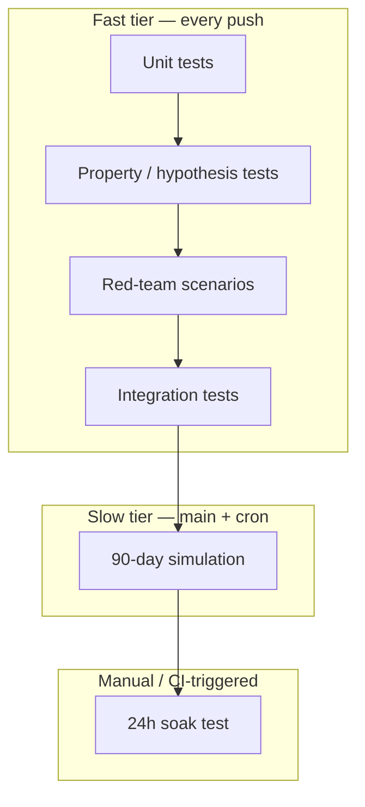

# Testing strategy

How we test the Darwin platform, what each tier proves, and how to write new tests when a new threat or failure mode is discovered. This doc connects the security threat model (doc 24) and the operational runbook (doc 25) back to the codebase's test suite.

## Philosophy

1. **Tests prove safety properties, not features.** A Darwin being smart is the LLM's job; our tests prove the *bounds* hold — kill switch fires, audit chain is unbroken, treasury policy refuses illegal payments, patches to DNA are rejected.
2. **Adversarial by default.** `conftest.py` declares: "Tests assume an adversarial soma on the hot paths." Every safety-critical module has at least one test that tries to break it from the soma's perspective.
3. **Determinism is mandatory.** Every test that doesn't touch a real external service must be deterministic. `FakeLLM`, `FakeWallet`, `VClock` — the fakes exist so tests are reproducible on any machine, zero network, zero keys.
4. **Speed tiers are labeled.** Tests that complete in < 5s are unmarked. Tests that need > 5s are `@pytest.mark.slow`. CI runs fast tests on every push; slow tests on main + weekly cron.

## Test tiers



### Tier 1: Unit tests

**What:** Single-module tests. Each file in `tests/unit/<package>/<area>/test_<module>.py` tests one module in isolation. The `tests/unit/` tree mirrors `src/`: a test for `src/darwin_dna/machinery/kill_switch.py` lives at `tests/unit/darwin_dna/machinery/test_kill_switch.py`.

**Examples:**
- `tests/unit/darwin_dna/machinery/test_kill_switch.py` — `KillSwitch` raises on flip, stays tripped
- `tests/unit/darwin_dna/machinery/test_audit_logger.py` — chain hashing, verification, append-only semantics
- `tests/unit/darwin_dna/machinery/test_ledger.py` — balance tracking, reconciliation
- `tests/unit/darwin_dna/machinery/test_patch_validator.py` — rejects DNA paths, allows soma paths
- `tests/unit/darwin_dna/machinery/test_fitness.py` — weight computation, counter-pressures
- `tests/unit/darwin_dna/constitution/test_constitution.py` — top-level invariant assertions
- `tests/unit/darwin_dna/constitution/test_spend_limits.py` — `effective_caps` + `check_within_caps` against every refusal axis
- `tests/unit/darwin_dna/constitution/test_forbidden_actions.py` — every `ForbiddenAction` enum value
- `tests/unit/darwin_dna/constitution/test_escalation_rules.py` — escalation ordering + ticket-class timeouts
- `tests/unit/darwin_dna/test_identity.py` — `uuid7` ordering, lineage extension
- `tests/unit/darwin_dna/test_hyperparameters.py` — `HardCaps` / `Hyperparameters` validators

**Coverage expectation:** Every public function in `darwin_dna/machinery/`, `darwin_dna/constitution/`, and every `darwin_platform/` bounded context (`runtime/`, `tenancy/`, `payments/`, `security/`, `observability/`, `escalations/`, `evolution/`, `infra/`, `adapters/`, `k8s/`) has at least one unit test. Hot-path modules (kill switch, audit, treasury, patch validator, spend limits, forbidden actions) have ≥ 10 test cases each.

**How to add:** Create a `tests/unit/<package>/<area>/test_<module>.py` file mirroring the source path. Import the module directly, construct it with fakes, assert the property.

### Tier 2: Property / hypothesis tests

**What:** Generalized assertions over random inputs. Uses `hypothesis` to explore edge cases the example-based tests miss. Lives under `tests/property/`.

**Examples:**
- `tests/property/test_kill_switch_properties.py` — arbitrary flip timing, arbitrary reason strings, finality after flag glitch
- `tests/property/test_trust_root_properties.py` — randomly-shaped sealed chains; every tamper/reorder/replay is caught

**Coverage expectation:** Every module in the adversarial soma contract (doc 24 § "What the soma will try") has a property test for its core invariant.

**How to add:**
```python
from hypothesis import given, settings
from hypothesis import strategies as st

@settings(max_examples=80, deadline=None)
@given(flip_at=st.integers(0, 20), reason=st.one_of(st.none(), st.text(max_size=40)))
def test_kill_is_final(flip_at, reason):
    # ... construct a KillSwitch with a source that flips at flip_at ...
    # ... assert: once tripped, it stays tripped regardless of source state ...
```

### Tier 3: Red-team scenarios

**What:** Scripted adversarial inputs that try to break each hot path's safety property. Lives under `tests/redteam/` with one file per threat class so each file ties cleanly to a single row in doc 24.

**Mapping to threat model (doc 24):**

| Threat (doc 24) | Red-team file |
| --------------- | ------------- |
| Audit chain tamper / forgery | `tests/redteam/test_audit_tamper.py` |
| Vault cross-read / grant replay / path smuggle | `tests/redteam/test_vault_cross_read.py` |
| Sanctions case / prefix evasion | `tests/redteam/test_sanctions_evasion.py` |
| Fence-marker injection / forgery | `tests/redteam/test_fence_escape.py` |
| Spread-spend smear | `tests/redteam/test_spread_spend_evasion.py` |
| Watermark forgery / removal | `tests/redteam/test_watermark_forgery.py` |
| Cross-pollination lesson poison | `tests/redteam/test_cross_pollination_poison.py` |
| Path-C neuron-proposal escalation | `tests/redteam/test_pathc_escalation.py` |
| Genome manifest forgery | `tests/redteam/test_manifest_forgery.py` |

**Coverage expectation:** Every row in doc 24's "Why the soma cannot succeed" table has at least one red-team test in its own file.

**How to add:** When a new attack vector is discovered (e.g., from a post-mortem or a creative fuzzing result), add a *new file* `tests/redteam/test_<threat_class>.py` that:
1. Names the threat in the module docstring (reference doc 24).
2. Constructs the attack (e.g., tampered record, forged marker, blocked path).
3. Asserts the defense fires (exception raised, request refused, alert emitted).
4. Asserts the refusal is *visible* (audit record, alert, kill) — silent failures are bugs.

### Tier 4: Integration tests

**What:** Multi-module tests that exercise a full path through the system (boot → loop → dispatch → persist → resume). Lives under `tests/integration/`.

**Examples:**
- `tests/integration/test_boot_integration.py` — boot a Darwin, run heartbeats, verify full loop
- `tests/integration/test_platform_supervisor.py` — spawn via Supervisor, drive loop, kill, verify persistence
- `tests/integration/test_platform_api.py` — HTTP endpoints against a real FastAPI TestClient
- `tests/integration/test_runtime_resume.py` — checkpoint, crash, re-boot, verify state continuity
- `tests/integration/test_pathc_orchestrator.py` / `test_pathc_runtime_wiring.py` — propose → validate → apply pipeline
- `tests/integration/test_cross_pollination_inject.py` / `test_cross_pollination_wiring.py` — read-side at child boot, Supervisor wiring

**Coverage expectation:** Every API endpoint has at least one integration test. The spawn→loop→kill→verify path is tested end-to-end.

### Tier 5: 90-day simulation (`tests/simulation/`, marker `slow`)

**What:** A simulated Darwin running for 90 in-sim days, asserting 8 invariants across the entire lifecycle (including reproduction). Files live under `tests/simulation/` and are auto-tagged `slow` by the tier's `conftest.py`, so `pytest -m "not slow"` skips them. Uses `tools/sim/run_sim.py`.

**Invariants asserted:**
1. Darwin survives 90 days without halting (unless killed by design).
2. Ledger reconciles to wallet with zero discrepancy at every checkpoint.
3. Audit chain is unbroken from birth to death.
4. Fitness is non-negative and monotonically non-decreasing over 7-day windows (after warm-up).
5. Kill switch fires within 1 heartbeat of flip.
6. Treasury hard caps are never breached (no single action > $50, no day > $500).
7. Reproduction fires when conditions are met; child boots and loops independently.
8. Mutation archive records all proposals; promoted mutations improve fitness.

**When it runs:** Push to main, weekly cron, manual trigger. ~2–5 minutes wall-clock.

### Tier 6: 24h soak test (manual / CI-triggered)

**What:** A real Darwin running against real (or compose-level) infrastructure for 24+ hours. Pass criteria defined in doc 20 § "The soak test."

**When it runs:** Before each phase gate. Not part of the normal CI loop — too slow and too expensive.

## Test infrastructure

### Fakes

The `darwin_fakes` package provides deterministic stand-ins:

| Fake | What it replaces | Key property |
| ---- | ---------------- | ------------ |
| `FakeStack` | Full platform bundle | All-in-memory, no I/O |
| `FakeLLM` | LiteLLM transport | Returns deterministic responses per task kind |
| `FakeWallet` | On-chain wallet | In-memory USDC ledger, instant settlement |
| `FakeVault` | HashiCorp Vault | In-memory KV store with tier enforcement |
| `FakeBrowser` | Browserbase | Returns canned page content |
| `FakeSandbox` | E2B microVM | Evaluates trivial code strings |
| `VClock` | `time.time()` | Controllable, deterministic |
| `MemoryAuditSink` | Postgres audit table | In-memory list with same append/read_all interface |
| `SigningService` | KMS / HSM | In-memory Ed25519 keypair |

### Shared fixtures (`conftest.py`)

| Fixture | Provides |
| ------- | -------- |
| `vclock` | A `VClock` instance (deterministic time) |
| `signer` | A `SigningService` (fresh keypair per test) |
| `genesis` | A validly signed generation-0 DNA bundle |
| `booted` | A fully booted `DarwinRuntime` against the fake stack |

### Marks

Tier markers are added automatically by the per-tier `conftest.py` files (`tests/unit/conftest.py`, `tests/property/conftest.py`, …) — you do *not* need to decorate individual test functions with `@pytest.mark.unit` etc. The simulation tier's `conftest.py` additionally adds `slow` so `pytest -m "not slow"` skips every sim test even if individual files forgot the marker.

| Mark | Source | Meaning | CI behavior |
| ---- | ------ | ------- | ----------- |
| `unit` | auto, `tests/unit/**` | Tier-1 single-module unit test | every push |
| `property` | auto, `tests/property/**` | Tier-2 hypothesis test | every push |
| `redteam` | auto, `tests/redteam/**` | Tier-3 adversarial scenario | every push |
| `integration` | auto, `tests/integration/**` | Tier-4 multi-module flow | every push |
| `simulation` | auto, `tests/simulation/**` (also adds `slow`) | Tier-5 multi-day sim | main + weekly |
| `slow` | explicit or via simulation tier | Anything > 5s | main + weekly |
| `asyncio` | explicit (pytest-asyncio) | Async test | normal |

## Coverage gaps and priorities

When deciding what to test next, consult these sources in order:

1. **Doc 24 (threat model)** — any row in the "Why the soma cannot succeed" table without a corresponding red-team test is a gap.
2. **Doc 25 (runbook) failure modes** — each FM-* entry implies at least one test that exercises the detection signal.
3. **The mutation archive** — every rejected patch shape that makes it past initial validation reveals a validator gap worth a test.
4. **Post-mortem entries** (doc 29) — every incident produces a regression test.

## Writing a new test: checklist

1. **Identify the tier.** Unit? Property? Red-team? Integration? Simulation?
2. **Choose the file path.**
   - One module of `src/`: `tests/unit/<package>/<area>/test_<module>.py` (mirrors src).
   - A hypothesis property: `tests/property/test_<property>_properties.py`.
   - An adversarial scenario: `tests/redteam/test_<threat_class>.py` — one file per doc-24 row.
   - A multi-module flow: `tests/integration/test_<flow>.py`.
   - A multi-day in-sim invariant: `tests/simulation/test_<scenario>.py`.
3. **Use fakes, not mocks.** Import from `darwin_fakes`. Mocks hide bugs; fakes behave like real implementations with controlled inputs.
4. **Assert the safety property, not the implementation.** "The kill signal fires" not "the internal counter incremented."
5. **Reference the source doc.** In the docstring, cite which hot path (doc 18), which threat (doc 24), or which failure mode (doc 25) this test covers.
6. **Verify visibility.** If the defense triggers, assert something externally observable happened (audit record, alert, exception, status change).
7. **Keep it fast.** If the test needs > 5s, mark it `@pytest.mark.slow` and justify why. Anything you put under `tests/simulation/` is auto-`slow`.

## Running tests

The repo root [`Makefile`](../../Makefile) wraps the commands below (`make test-fast`, `make test-all`, `make test-unit`, …). Run `make help` for the full list.

```bash
# Fast tier (every push):
uv run pytest -m "not slow"
# or: make test-fast

# Full suite including simulation:
uv run pytest
# or: make test-all

# Just the red-team suite (by path):
uv run pytest tests/redteam -v

# Just the red-team suite (by marker — works wherever the file sits):
uv run pytest -m redteam -v

# Just the property tests:
uv run pytest tests/property -v

# One tier at a time:
uv run pytest tests/unit
uv run pytest tests/integration
uv run pytest tests/simulation

# With coverage:
uv run pytest --cov=darwin_dna --cov=darwin_platform --cov-report=term-missing
```
