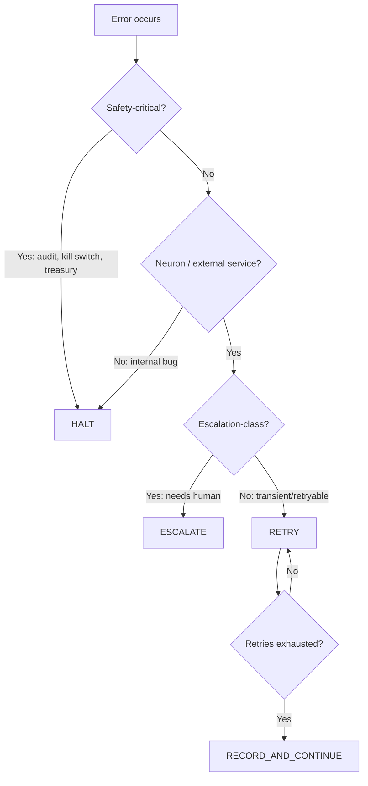

# Cross-cutting contracts

The invisible rules that every module follows but no single module owns. These contracts are what checkpoint recovery, the audit chain, and the kill switch depend on. Violating any of them is a bug — not a feature request.

## Error handling philosophy

The genome classifies every error into exactly one of four responses. There is no fifth option.

### The four responses



| Response | When | What happens | Example |
| -------- | ---- | ------------ | ------- |
| **HALT** | Safety-critical system failure | Darwin dies immediately; audit records the halt; the supervisor marks it killed | `AuditError`, treasury policy engine bug, constitution violation |
| **ESCALATE** | The task needs human input | Ticket is filed; task is parked in `open_escalations`; the Darwin moves on to other work; the task resumes verbatim when the owner answers | Captcha, KYC verification, approval-required payment |
| **RETRY** | Transient external failure | The neuron's `execute()` failed; the loop records the failure and may retry on the next heartbeat if the same task is re-proposed | Rate limit, network timeout, temporary 5xx |
| **CONTINUE** | Permanent but non-fatal failure | The failure is recorded in episodic memory; `recurring_failures` is bumped; the loop moves on; if the same failure recurs enough, the mutation gate opens | API permanently revoked, resource not found |

### Rules

1. **An `AuditError` is always HALT.** No exceptions. "No log, no action" (P7). If we can't record it, we don't do it, and we stop trying.
2. **A `KillSignal` is always HALT.** It's a `BaseException`. Nothing catches it except the halt sequence.
3. **A neuron crash is never HALT.** A neuron blowing up is the soma's problem; the organism survives its own tools failing. The exception is caught, logged, and the loop continues.
4. **Escalation is not failure.** A task that escalates is not counted as failed in `recurring_failures`. It's parked. The Darwin doesn't retry it — it waits for the human.
5. **Internal bugs are HALT.** An unhandled exception from *orchestrator code* (not neuron code) indicates a bug in the genome or platform. The Darwin halts and the post-mortem investigates.

### Exception hierarchy

```
BaseException
├── KillSignal          → HALT (always; uncatchable by `except Exception`)
├── SystemExit          → HALT (process-level; supervisor handles)
└── Exception
    ├── AuditError      → HALT (audit chain integrity)
    ├── NeuronError     → RETRY / CONTINUE (neuron-level, non-fatal)
    ├── EscalationNeeded → ESCALATE (explicitly raised by neurons)
    └── (everything else) → HALT if from orchestrator; RETRY if from neuron
```

## Timeout conventions

Every external call has a timeout. Hanging forever is not an option — a stuck Darwin wastes money and blocks heartbeats.

| Operation | Timeout | On timeout |
| --------- | ------- | ---------- |
| LLM completion (fast tier) | 30s | RETRY (backoff) |
| LLM completion (reasoning tier) | 120s | RETRY (backoff) |
| LLM completion (coding tier) | 300s | RETRY once, then CONTINUE |
| Browser session (page load) | 60s | RETRY |
| Browser session (total task) | 300s | CONTINUE (record failure) |
| Sandbox code execution | 30s | CONTINUE |
| Wallet on-chain transfer | 60s | RETRY (wait for confirmation) |
| Vault read/write | 10s | RETRY (3 attempts) |
| x402 payment settlement | 30s | RETRY |
| Escalation response poll | 0s (non-blocking) | CONTINUE (check next heartbeat) |
| Platform health check | 5s | — (k8s restarts the pod) |

### The LiteLLM circuit breaker

The `LiteLLMTransport` adapter includes a per-model circuit breaker:

- **Closed** (normal): requests pass through.
- **Open** (tripped): after N consecutive failures on one model, the circuit opens and requests immediately fail with a cached error for a cooldown window.
- **Half-open** (probing): after cooldown, one request passes through. If it succeeds, the circuit closes. If it fails, it re-opens.

This prevents a degraded LLM from burning retries and money. The Darwin degrades to a cheaper tier or waits.

## Retry policy

### Neuron-level retries

Neurons do **not** retry internally. The orchestrator's loop is the retry mechanism:

1. Neuron fails → recorded in episodic memory.
2. Next heartbeat: the planner sees the failure in recent observations.
3. If the planner re-proposes the same task, the dispatch node retries.
4. If the planner chooses a different task, the failed one is abandoned (for now).

This is by design: the planner can reason about whether a retry makes sense (was the failure transient? did the context change?) rather than blindly retrying.

### Platform-level retries

Platform components (persistence, leadership, monitoring) retry transient failures silently:

| Component | Strategy | Max attempts | Backoff |
| --------- | -------- | ------------ | ------- |
| Postgres connection | Reconnect | 5 | Exponential (1s, 2s, 4s, 8s, 16s) |
| Advisory lock polling | Re-poll | ∞ (until leader won) | Fixed 1s |
| Notification sink (Slack/webhook) | Retry | 3 | Linear (5s, 10s, 15s) |
| Sanctions screening API | Retry | 2 | Fixed 2s |
| OTEL trace export | Fire-and-forget | 1 | None (best-effort) |

### What is never retried

- **Audit writes.** If the sink fails, HALT. There is no "try again later."
- **Kill switch checks.** If the source is unreachable, assume killed (fail-safe).
- **Treasury policy decisions.** If the policy engine errors, refuse the payment (fail-closed).

## Idempotency guarantees

### Which operations are safe to replay on restart?

| Operation | Idempotent? | Why / mechanism |
| --------- | ----------- | --------------- |
| Boot from checkpoint | Yes | Checkpoint is a pure snapshot; re-booting produces the same graph state |
| Re-verify audit chain | Yes | Read-only hash verification; no side effects |
| Re-run a heartbeat from the same checkpoint | **No** | A heartbeat has side effects (neuron dispatch, payment). But the write-before-act pattern means: if the intent was logged, the outcome is either logged (complete) or absent (safe to re-execute) |
| Persist checkpoint | Yes | Upsert by `darwin_id`; overwriting with the same state is a no-op |
| Persist audit record | **Conditionally** | Append-only; same seq with same hash is idempotent; different hash at same seq is a chain break → HALT |
| Wallet transfer | **No** | On-chain transfers are final. The intent log prevents double-spend: if the intent is logged but no outcome, the reconciliation detects the gap |
| Escalation post | Yes | Deduped by `ticket_id`; posting the same ticket twice is a no-op |
| Manifest persistence | Yes | Upsert by `darwin_id`; same manifest is a no-op |

### The write-before-act pattern

Every side-effecting action follows this protocol:

```
1. log_intent(kind, payload)   → returns intent_id
2. perform the action
3. log_outcome(intent_id, status, detail)
```

On crash between steps 1 and 3:
- The intent is logged but no outcome exists.
- On restart, the audit chain has the intent but no closure.
- The reconciliation logic can detect "open intents" and either:
  - Re-execute (if the action is idempotent, e.g., publishing a blog post).
  - Alert the operator (if the action is non-idempotent, e.g., wallet transfer).

This is not full exactly-once semantics. It's at-most-once for payments (fail-safe: refuse rather than double-pay) and at-least-once for reads/publishes (a duplicate blog post is less harmful than a lost one).

### Checkpoint atomicity

The checkpoint write (`darwin_checkpoints` upsert) is a single SQL statement. The state is either fully written or not at all. There is no partial checkpoint.

If the supervisor crashes between "checkpoint written" and "next heartbeat started," the restart replays from the checkpoint — the next heartbeat runs again. The audit chain may have an intent from the aborted heartbeat (if one was logged); the restart's reconciliation detects it.

## Ordering guarantees

### Within one Darwin

- **Audit records:** Strictly ordered by `seq`. No gaps, no reordering. Enforced by the `_lock` in `AuditLogger`.
- **Heartbeats:** Sequential within one drive loop. No concurrent heartbeats for the same Darwin.
- **Neuron dispatches:** One at a time per heartbeat (current architecture). Parallel dispatch is a Phase 3 experiment.
- **Escalation responses:** Processed in poll order (FIFO from the inbox).

### Across Darwins

- **No ordering guarantees.** Darwins are fully independent; they share no state and cannot observe each other's timing.
- **Platform-level operations** (billing sweep, monitoring scan) run on a per-Darwin basis; the scan order is deterministic (alphabetical by `darwin_id`) but has no semantic meaning.

## Concurrency model

### Phase 0–1 (in-process driver)

Each Darwin is an `asyncio.Task` inside the supervisor's event loop. Concurrency is cooperative:

- One heartbeat runs at a time per Darwin (the drive loop awaits each heartbeat).
- Multiple Darwins run concurrently (asyncio scheduling).
- Persistence writes are serialized by the `_Backend`'s connection lock (SQLite) or transaction isolation (Postgres).

### Phase 2 (K8s driver)

Each Darwin is a separate pod. No shared memory. All communication is via:

- The platform DB (checkpoints, audit mirrors, billing).
- The escalation inbox (HTTP poll from genome → supervisor).
- The kill-switch source (HTTP poll from genome → supervisor).

## Fail-safe defaults

When in doubt, the system fails safe:

| Situation | Fail-safe behavior |
| --------- | ------------------ |
| Kill switch source unreachable | Treat as killed (stop) |
| Treasury policy evaluation errors | Refuse the payment |
| Audit sink write fails | HALT the Darwin |
| Sanctions API timeout | Block the transfer (retry later) |
| LLM API down | Darwin pauses (no dispatches); does not die |
| Vault unreachable | Neurons that need secrets fail; Darwin continues on non-secret tasks |
| Egress proxy down | All external calls fail; Darwin enters degraded mode |
| Persistence unreachable | Supervisor stops driving loops (cannot checkpoint safely) |
